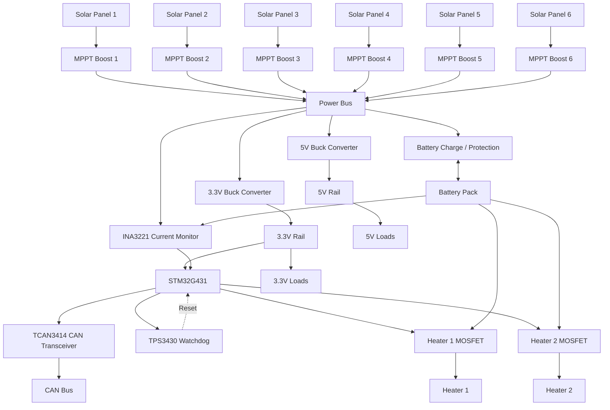
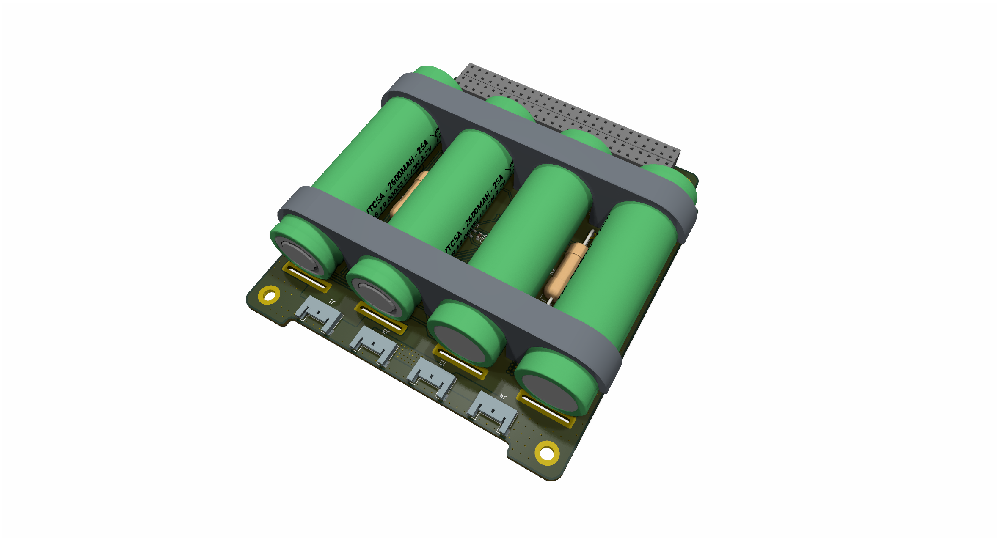
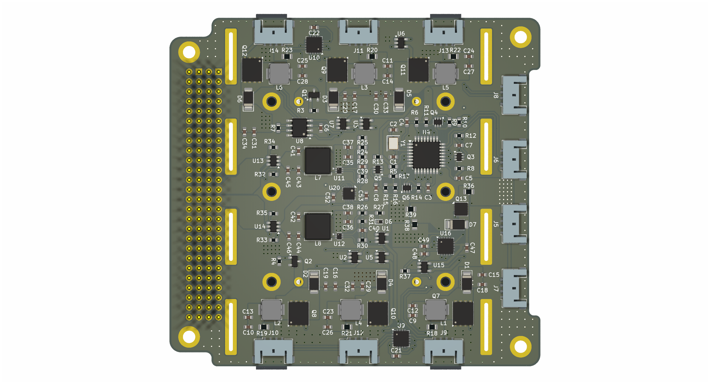

# CubeSat-EPS

This is a EPS (Electric Power System) designed for 2U - 6U CubeSats.
The EPS contains 4 18650 Li-ion batteries in 2S2P configuartion.
Two power output rails are provided with 3.3v, 5v output, and 4A each.
Six MPPT (Maximum Power Point Tracking) boost converter connects the solar panels to the main bus.

## Hardware

Block diagram:

Top view:

Back View:

